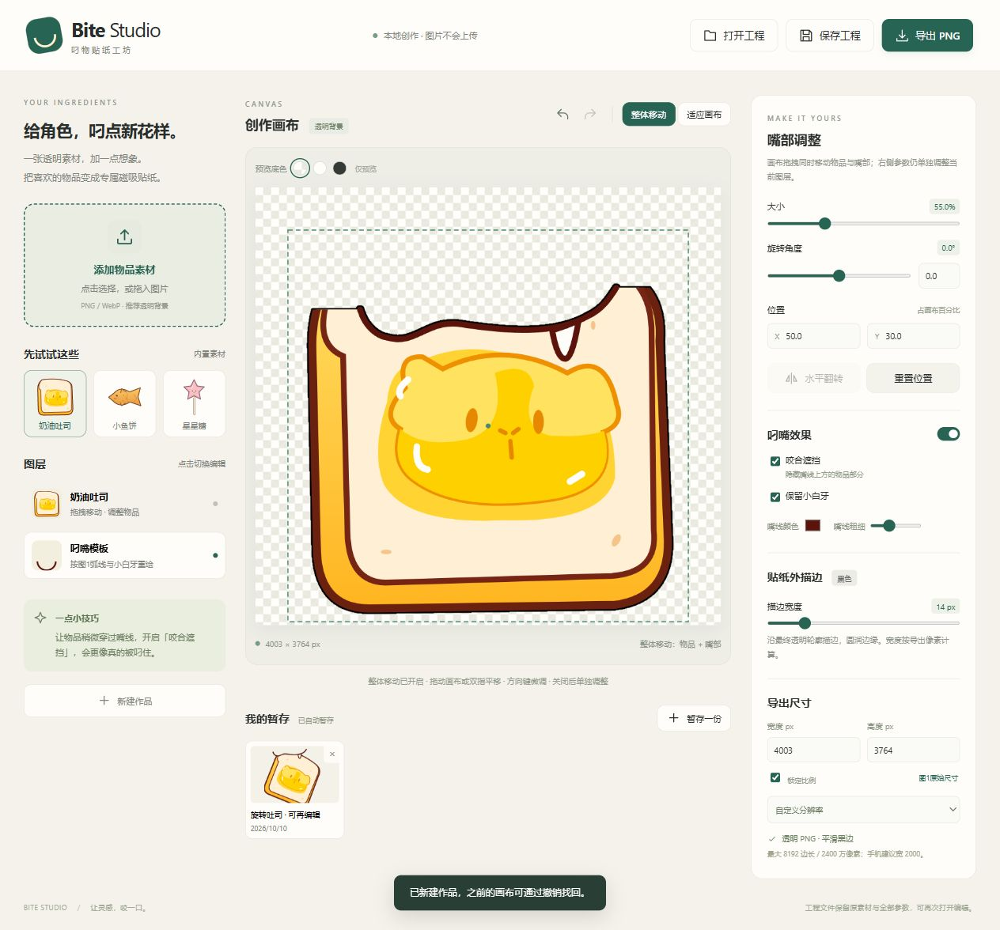

# Bite Studio · 叼物贴纸工坊

一个轻量、离线运行的透明 PNG 贴纸编辑器。上传物品素材，调整嘴部与物品的位置，生成角色「叼着物品」的贴纸图片。



## 功能

- 上传 PNG、WebP 或 JPEG，自动排除外围透明留白与几乎不可见的杂点，让选框和手柄围绕实际物品。
- 拖拽移动、四角缩放、四个旋转手柄，支持精确输入参数。
- 「整体移动」同步移动嘴部与物品，保留相对位置。
- 独立调整嘴部，开启咬合遮挡、白牙与线条颜色、粗细。
- 自定义透明 PNG 导出尺寸，默认 4003 × 3764，生成平滑外描边，颜色可自定义，默认白色。
- 贴纸效果测试：上传背景照片，将当前作品整体放上去，背景与贴纸均可独立拖动、缩放、旋转，并保存合成效果图。
- IndexedDB 自动暂存、命名暂存、撤销与重做；`.bite` 工程保留原素材和全部参数，可再次编辑。
- 桌面、平板和手机响应式布局；触屏手势已实现，Android 真机兼容性仍需验证。

## 开始使用

### 手机 / 在线使用

直接打开 **[Bite Studio 在线编辑器](https://141grayfox.github.io/bite-studio/)**。手机无需安装 Node.js 或 APK。

[查看在线版手机布局](在线手机界面.jpg)。页面底部可打开本项目的 GitHub 仓库。

上传图片、调整图层、导出 PNG 和保存工程都在当前浏览器内完成。手机导出可使用系统分享面板或浏览器下载；不同手机的文件保存入口可能不同。

暂存属于当前设备和浏览器。电脑上的暂存不会自动出现在手机上，需要在电脑「保存工程」，把 `.bite` 文件传到手机后「打开工程」。手机首次使用可先选择宽 2000 的导出尺寸。

### Windows / 本机使用

Windows 用户可双击 **启动工坊.cmd**。本机已有 Node.js 时，会启动仅监听本机的服务并打开浏览器。

跨平台运行：

```sh
node server.cjs
```

然后打开 <http://127.0.0.1:43971/>。不需要 `npm install`，没有第三方运行时依赖。

`BiteStudio.html` 是独立主程序，可直接下载。浏览器直接打开文件的存储与下载行为可能不同，本项目已实际验证的是上述本地服务入口。

## 开发与验证

```sh
# 从 src/ 重建独立 HTML
node build.cjs

# 运行描边、透明边界与变换回归测试
node tests/renderer.test.cjs
```

修改 `src/` 后重新构建，刷新浏览器即可使用。构建同时更新独立主程序和 `docs/index.html`；提交并推送到 `main` 后，GitHub Pages 自动发布 `docs/`。当前数值回归测试为 22 项，覆盖默认白色与自定义描边颜色、半透明颜色混合、边缘透明度、杂点排除、淡图回退，以及旋转/翻转后收紧边界时的像素位置保持。

效果测试的浏览器回归可运行 `node tests/mockup.browser.test.cjs`，需要开发环境提供 Playwright 与 Chromium。可通过 `BITE_PLAYWRIGHT_PATH` 指定 Playwright 模块路径、`BITE_CHROME_PATH` 指定本机 Chrome/Chromium 可执行文件。测试自行启动临时预览服务，覆盖鼠标/双指操作、合成 PNG 像素、空贴纸与关闭窗口的恢复；正式程序不需要这些测试依赖。

## 目录

| 路径 | 内容 |
| --- | --- |
| `src/index.html` | 界面结构 |
| `src/style.css` | 响应式样式 |
| `src/app.js` | 图层交互、工程、暂存、导出 |
| `src/mockup.js` | 照片效果测试、贴纸整体变换、合成效果图导出 |
| `src/renderer.js` | Canvas 合成、可见边界检测、平滑描边 |
| `tests/mockup.browser.test.cjs` | 效果测试浏览器交互与合成 PNG 验证（需 Playwright） |
| `tests/renderer.test.cjs` | 无依赖数值回归测试 |
| `build.cjs` | 单文件打包 |
| `server.cjs` | 本机预览服务 |
| `BiteStudio.html` | 可直接使用的构建产物 |
| `docs/index.html` | GitHub Pages 的在线入口，与独立主程序一致 |
| `示例-吐司.bite` / `示例-吐司.png` | 可编辑示例与导出示例 |

完整操作说明见 [使用说明](使用说明.md)，架构、验证范围和 Android 移植说明见 [技术说明与验证](技术说明与验证.md)。

## 数据与兼容性

素材在浏览器内处理，本地服务没有上传接口。预览网格与编辑手柄不会进入导出图片。

当前版本依据参考弧线与白牙重绘了矢量嘴部模板，内置图片为演示素材。程序生成像素图片，不生成印刷刀模。

尚未验证 Android 真机、Safari、极限分辨率和低内存设备；当前仓库不包含 Android APK。
